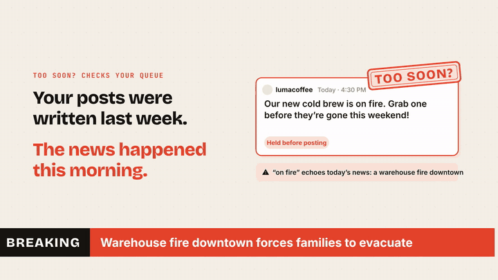
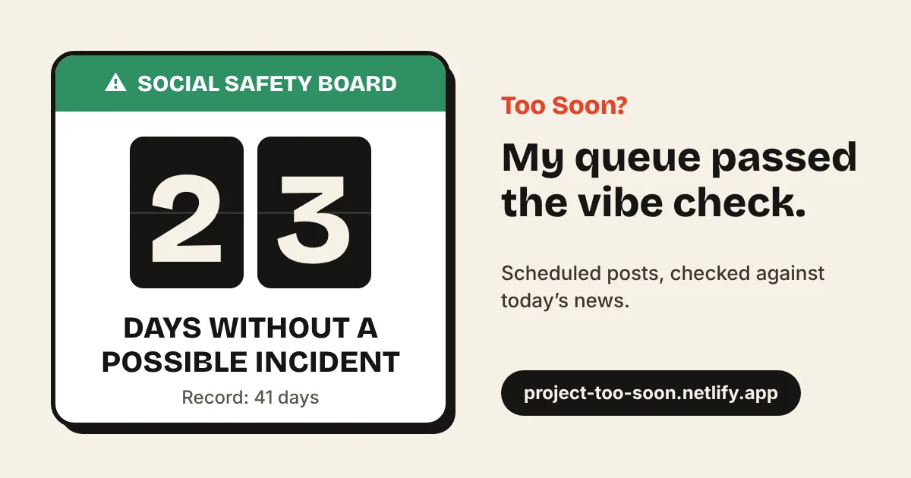
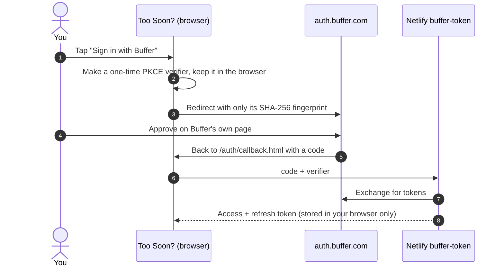

<div align="center">


# Too Soon? 😬

### Check your Buffer queue against today's news,<br>before your post *becomes* the news.

[](https://project-too-soon.netlify.app/app.html?demo)
[](https://buffer.com)
[](#)



**[Try the demo](https://project-too-soon.netlify.app/app.html?demo)** · **[Sign in with Buffer](https://project-too-soon.netlify.app/app.html?connect)** · **[The story, animated](https://project-too-soon.netlify.app/story.html)** · **[The Guide: 7 famous blunders](https://project-too-soon.netlify.app/guide.html)** · **[Brand kit](brand/)**

</div>

---

## 📖 The story

I've spent years running social media and PR, and I've watched too many brands not read the room.

It's rarely carelessness. It goes like this:

| 🗓 Monday | 📰 Thursday, 8:00 AM | 📤 Thursday, 4:30 PM |
| --- | --- | --- |
| "Our new cold brew is on fire 🔥" goes in the queue. | A warehouse fire downtown forces families to evacuate. | The post goes out anyway. Screenshots. Apology. Meeting. |

Scheduling tools are great at sending posts on time. **Nobody was checking whether the time was still right.** So I built a small but mighty tool that reads the room for you. Or in this case, your queue. 👀

> SpaghettiOs on Pearl Harbor Day. DiGiorno jumping into a hashtag it hadn't read. Gap tweeting about a hurricane. Big brands with full teams still got it wrong. Agencies juggling ten clients have even less time to read the news for each one.

---

## ✨ What it does

Two columns: **today's news on the left, your scheduled Buffer posts on the right.** Every post gets a stamp and a plain-English reason that links to the story behind it.

| Stamp | When |
| --- | --- |
| 🟥 **Too soon** | Names someone in tragic news, echoes a disaster ("on fire" next to a fire), ties a promo to a solemn day, links to a dead or sold-out page, or says a date that will already have passed |
| 🟨 **Give it a look** | A place under a weather alert, a developing story, a tribute post on a solemn day |
| 🟩 **You're good** | Nothing in today's news touches it |

Then fix it right there:

- ✍️ **Rewrite** in the card, with a live check as you type
- ⏭ **Push back a day** and let the news cycle move on
- 📥 **Pull to drafts**, one post or all of them. Nothing is ever deleted
- ✨ **Ask AI** for a one-line read on the risk plus a rewrite (flagged posts only)
- 🌑 **Go dark** on a really bad day: everything coming up goes to drafts, plus a holding statement ready to edit
- 🔔 **Slack/Discord alerts** when a post turns too soon
- 🗂 **All clients**: every Buffer organization checked at once, with a sensitivity dial per client

And when the whole queue is clean? 🪧 A **"days without a possible incident"** board with flip numbers, proof of everything it checked, and a badge to brag with. One too-soon post and it's back to zero.

<p align="center"></p>

> [!IMPORTANT]
> **We get it, and it's still on you.** Too Soon? jokes about brands that posted at the worst moment, never about the moment itself: the news it reads is real and happened to real people. It's a work in progress and a second set of eyes, not the last set. It can miss things and flag things that are fine, so a human should still give every post a final read. Everyone agrees to this once, before the demo or sign-in, and can reread it anytime under **More → The fine print**.

---

## 🔑 Sign in with Buffer, reused from PostIQ

[PostIQ](https://postiq.netlify.app), my calendar companion for Buffer, already had a working sign-in. For Too Soon? I pulled that connection layer into shared files with three settings, so any of my apps can plug it in. **Sign-in took an afternoon instead of a week.**

```js
BufferConnection.init({
  prefix: 'toosoon',            // PostIQ uses 'postiq', so two apps on one browser never mix tokens
  clientId: CFG.BUFFER_CLIENT_ID, // public client id, served from a Netlify env var
  tokenEndpoint: '/.netlify/functions/buffer-token',
});
```



Buffer issued a **public client** for this app, so there's no client secret. That's fine: PKCE is built for apps that can't keep a secret. If a secret is ever added, `buffer-token` attaches it on the server and the browser never sees it. Pasting an API key still works as a fallback.

---

## 🧩 How it talks to Buffer

```
🖥 Your browser  ──►  ⚡ Netlify functions  ──►  🟩 api.buffer.com (GraphQL)
  the whole app        buffer-proxy (origin allowlist)
  rules engine         buffer-token (OAuth)
  tokens + settings    headlines · check-page · second-opinion · notify
```

**The promise, enforced in code:** ✅ Read · ✅ Edit when you tap · ✅ Save to drafts · ❌ ~~Publish~~ · ❌ ~~Delete~~

<details>
<summary><b>📜 The GraphQL calls (click to expand)</b></summary>

**Read the queue** (50 at a time, with image alt text; retries without assets if Buffer rejects that part)
```graphql
query P($organizationId: OrganizationId!, $after: String) {
  posts(first: 50, after: $after,
        input: { organizationId: $organizationId, filter: { status: [scheduled] } }) {
    edges { node { id text dueAt channelId
      assets { ... on ImageAsset { image { altText } } } } }
    pageInfo { hasNextPage endCursor }
  }
}
```

**Pull to drafts** (re-reads the post first and refuses if it's no longer scheduled)
```graphql
mutation { editPost(input: { id: "…", saveToDraft: true }) {
  ... on PostActionSuccess { post { id status } }
  ... on MutationError { message } } }
```

**Push back a day** (same time tomorrow, in your local offset)
```graphql
mutation { editPost(input: { id: "…", mode: customScheduled, dueAt: "2026-11-14T16:30:00-06:00" }) {
  ... on PostActionSuccess { post { id dueAt } }
  ... on MutationError { message } } }
```

**Holding statement into drafts** (Facebook needs `metadata.facebook.type`)
```graphql
mutation { createPost(input: { channelId: "…", text: "We're pausing our regular posts today…",
  schedulingType: automatic, mode: addToQueue, saveToDraft: true,
  metadata: { facebook: { type: post } } }) {
  ... on PostActionSuccess { post { id } }
  ... on MutationError { message } } }
```
</details>

---

## 📡 Reading the room

No paid news API, no scraping. Every source is public and free, merged by one Netlify function so the browser makes a single request.

| | Source | From | Default |
| --- | --- | --- | --- |
| 📰 | Top headlines | Google News RSS | On |
| ⛈️ | Severe weather | National Weather Service (marine zones filtered out) | On |
| 🕯️ | People in the news | Wikipedia most-read + Wikidata (humans only, recent deaths confirmed) | On |
| 📈 | Trending searches | Google Trends, with the headline behind each trend | On |
| 🌍 | Quakes & disasters | USGS significant quakes, GDACS orange/red (no long-running droughts) | On |
| 🥫 | Recalls | openFDA food + CPSC products | On |
| 🗓️ | Sensitive days | Built in: 9/11, Pearl Harbor, MLK Day, Memorial Day… | On |
| 🏙️ | Your city | Google News search | Add in Settings |
| 🏷️ | Your brand in the news | Google News search for names learned from your queue | Automatic |
| 💬 | Bluesky + Reddit chatter | Last day of public posts about your brand and watch words, one summary line per term. Best effort: Reddit often blocks cloud servers, and the app skips it quietly | On |

**The rules engine** ([`js/rules.js`](js/rules.js), 255 lines, runs in the browser and in Node) pulls names, places, handles and hashtags out of each post and compares them with the headlines. It knows "Jordan Vale" is a deliberate reference and a lone word in a story is probably a coincidence. When people are **criticizing your brand on Bluesky or Reddit**, every promo gets "Give it a look" until it cools down; criticism of a watch word flags posts that mention it. It also catches **tone echoes** ("killer deal" next to a shooting), passed dates, places under alerts, sensitive days, and dead, sold-out or cancelled links. Tidy-ups flag duplicates, character limits, leftover [brackets] and missing alt text without changing the verdict.

**AI only where it earns its keep:** all posts → free rules → *flagged* posts → ✨ Claude Haiku or Gemini Flash, only when you tap → **you decide.** Bring your own key (Gemini has a free tier). It stays in your browser.

---

## 🎨 The taste pass

An app about tragedy-adjacent posts can easily become tasteless itself. Rule of thumb: **funny about posting, never funny about the news.**

| Before | After |
| --- | --- |
| Demo news day had a mall shooting | A warehouse fire. Still bad timing for "on fire 🔥," and nobody dies |
| Sad trombone on every counter reset | Only for light causes (dead link, passed date). Never for a tragedy |
| All-clear card could quote a death next to a smiling mug | The cheerful card never quotes tragic news or emergency alerts |
| 🐛 A months-old drought alert listing "Mexico, United States" flagged "our Mexico City street tacos" | Droughts and anything older than 10 days are dropped. Found by testing against live data |

---

## 🚀 Run your own

No build step. It's static HTML plus Netlify functions.

1. **Deploy to Netlify** (publish `.`, functions in `netlify/functions`).
2. **Register a Buffer OAuth app:** public client with PKCE, redirect URI `https://<your-site>/auth/callback.html`, scopes `posts:read posts:write account:read offline_access`.
3. **Add the environment variables** below, then **redeploy**.
4. Check the news feed: open `/.netlify/functions/headlines?sources=wiki,trends,quakes,gdacs,recalls` and look for `"kind":"news"`, `"people"` and `"trend"`.

| Variable | Needed? | What it does |
| --- | --- | --- |
| `BUFFER_CLIENT_ID` | ✅ For Sign in with Buffer | Public client id, served to the page by `app-config` |
| `BUFFER_ALLOWED_ORIGINS` | 👍 Recommended | Your site's URL, so the proxy only answers your site |
| `BUFFER_CLIENT_SECRET` | Only if Buffer issued one | Added server-side in `buffer-token`, never sent to the browser |
| `ANTHROPIC_API_KEY` / `GEMINI_API_KEY` | Optional | Site-wide AI second opinion (otherwise people bring their own key). `ANTHROPIC_MODEL` / `GEMINI_MODEL` override the defaults |

`netlify.toml` tells Netlify's secrets scan to skip the two public Buffer values.

**Handy URLs:** `/app.html?demo` (demo) · `?connect` (open sign-in) · `?allclear` (preview the all-clear screen) · `?tour` (replay the walkthrough)

### 🧪 Tests

```bash
npm test   # rules engine vs. the demo queue + every news source mocked (53 assertions)
```

---

## 🗂 What's where

| Path | What |
| --- | --- |
| `index.html` | Landing page (reel hero, product shots) |
| `app.html` · `js/app.js` · `css/app.css` | The two-column checker |
| `js/rules.js` | Rules engine |
| `js/allclear.js` | Streak board, closest call, share badge |
| `js/crisis.js` · `js/templates.js` | Go dark, holding statements, saves report, all clients |
| `js/agree.js` | The "we get it, and it's still on you" agreement, shown once before the demo or sign-in |
| `js/tour.js` | 7-step demo walkthrough |
| `js/demo.js` · `js/cases.js` · `js/calendar.js` | Demo coffee shop, the 7 case files, sensitive days |
| `js/shared/` | 🔁 Buffer connection + OAuth/PKCE, shared with PostIQ |
| `netlify/functions/buffer-proxy.js` · `buffer-token.js` · `_shared.js` | 🔁 Buffer API pass-through and token exchange, shared with PostIQ |
| `netlify/functions/headlines.js` · `_sources.js` | News, alerts and the free sources |
| `netlify/functions/check-page.js` | Link checker (blocks private IPs) |
| `netlify/functions/second-opinion.js` | AI second opinion (Claude or Gemini) |
| `netlify/functions/notify.js` | Slack/Discord webhooks (those hosts only) |
| `netlify/functions/app-config.js` | Hands the page its public client id |
| `story.html` · `guide.html` | The animated story · the blunders guide |
| `media/` · `images/product/` | Reel, poster, README GIF, product screenshots |
| `brand/` | 🎨 Brand kit: logos, colors, voice, share card, reel master + its source code |
| `favicon.*` · `icon-*.png` · `apple-touch-icon.png` · `site.webmanifest` | Site and home-screen icons |

<details>
<summary><b>🛠 Build log: 4 days, v0.1 → v0.9</b></summary>

- **v0.1 (Nov 9):** two-column checker, rules engine, demo mode, landing page.
- **v0.3–v0.4:** push back a day, copy for client, location alerts, rewrite in place, free sources (Wikipedia/Wikidata, Trends, USGS, GDACS, FDA, CPSC), sensitive days.
- **Sign in with Buffer:** shared PostIQ connection layer, client id from Netlify env vars.
- **v0.5:** the Guide (7 cases), auto-watchlist, brand mentions, Go dark, holding statements, Slack/Discord alerts, sensitivity dial, tidy-ups, all clients, saves report.
- **v0.6–v0.7:** 23-second reel built in code (canvas, 60fps, synthesized audio) as the landing hero; rebuilt landing; 7-step walkthrough.
- **v0.8:** ✨ Ask AI on every flagged post, AI rewrites, bring-your-own key. One walkthrough.
- **v0.9:** all-clear streak board + share badge, simpler connect, demo clears instantly, show demo posts while connected, share the app.
- **Polish:** taste pass, real product screenshots on the landing, live-data source cleanup, animated story page.
- **Nov 13:** Bluesky + Reddit brand chatter, the fine-print agreement before first use, QA pass (mobile overflow, accurate stamp descriptions), real logo and icons, share card, brand kit with the reel source.

</details>

---

<div align="center">

**Check before you wreck.** 🧯

Made by Ben Campbell · [Nobody Creative](https://nobody-creative.netlify.app) · built with Claude as a coding partner<br>
Built on Buffer's API. Not affiliated with Buffer or any news outlet.

</div>
