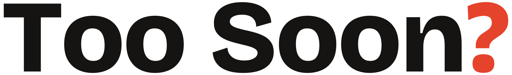
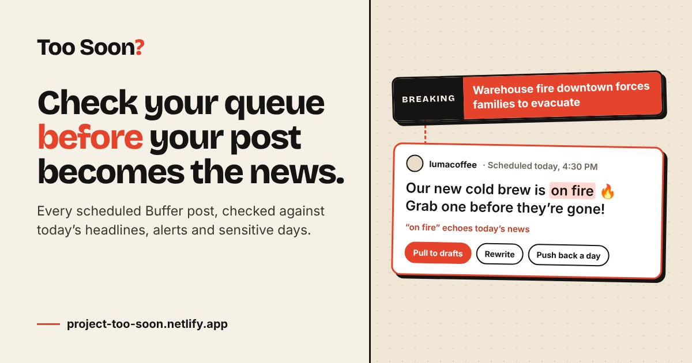
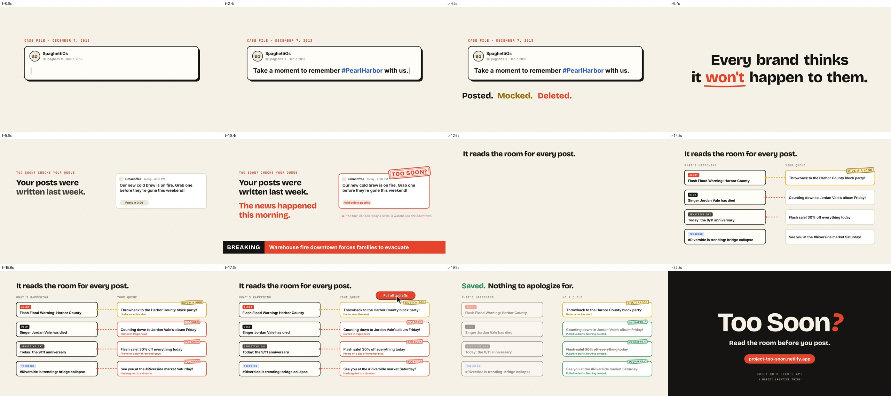

<div align="center">


# Too Soon? brand kit

Logos, colors, type, the share card and the reel, all in one place.

</div>

## 🧷 Logos

| File | Use it for |
| --- | --- |
| [`logo/too-soon-mark.svg`](logo/too-soon-mark.svg) · [`.png`](logo/too-soon-mark-512.png) | App icon, avatars, favicon. Red tile, cream "?" tilted like a stamp |
| [`logo/too-soon-mark-paper.svg`](logo/too-soon-mark-paper.svg) · [`.png`](logo/too-soon-mark-paper-512.png) | When the red tile is too loud: paper tile, ink border, red "?" |
| [`logo/too-soon-wordmark.svg`](logo/too-soon-wordmark.svg) · [`.png`](logo/too-soon-wordmark.png) | On paper or white |
| [`logo/too-soon-wordmark-light.svg`](logo/too-soon-wordmark-light.svg) · [`.png`](logo/too-soon-wordmark-light.png) | On ink or dark photos |

<p>
&nbsp;
&nbsp;&nbsp;

</p>

The letters are outlined from Bricolage Grotesque ExtraBold, so the SVGs look right without the font installed.

**Do:** keep the "?" red, give the logo room to breathe, and use the paper mark on busy backgrounds.
**Don't:** recolor the "?", stretch it, or put the red tile on another red.

Site icons live at the repo root: `favicon.svg`, `favicon.ico` (16/32/48), `apple-touch-icon.png` (180), `icon-192.png`, `icon-512.png`, listed in `site.webmanifest`.

## 🎨 Colors

| | Name | Hex | Where |
| --- | --- | --- | --- |
| 🟫 | Paper | `#f6f1e7` | Backgrounds |
| ⬛ | Ink | `#161412` | Text, borders, hard shadows |
| 🟥 | Too-soon red | `#e5432b` | The "?", Too soon stamps, primary buttons |
| 🟨 | Look amber | `#9a6a00` on `#fff3d4` | Give it a look stamps |
| 🟩 | Good green | `#2e8f62` on `#dcf1e5` | You're good stamps, the all-clear |
| 🟪 | AI purple | `#6c4ad0` on `#ece4ff` | Anything AI does (✨ Ask AI) |

The look: paper backgrounds, 2px ink borders, hard offset shadows (no blur), and stamps that slam in at a slight tilt.

## 🔤 Type

- **Bricolage Grotesque** 800 for headlines and stamps, tight tracking (about −0.035em)
- **Inter** 400–700 for everything else
- A monospace face for small uppercase labels and code

## 🗣 Voice

**Funny about posting. Never funny about the news.**
The jokes land on the marketer's panic ("hiding the intern's phone"), never on the people in the headlines. When the subject turns serious (Go dark, holding statements, the fine print), the voice goes plain and calm. Short sentences, plain English, no jargon.

## 🖼 Share card

[`social/og-card.jpg`](social/og-card.jpg) (1200×630) is what shows when the link is posted on Discord, Slack, LinkedIn, iMessage and X: a breaking headline colliding with a scheduled post, and the fixes. Every page points to it with absolute URLs. To change it, edit [`social/source/og-card.html`](social/source/og-card.html) and screenshot it at 1200×630.



## 🎬 The reel

| File | What |
| --- | --- |
| [`../media/too-soon-reel.mp4`](../media/too-soon-reel.mp4) | 23s share copy (1080p, about 3 MB). The landing page hero. Post this one |
| [`video/too-soon-reel-master.mp4`](video/too-soon-reel-master.mp4) | Higher-quality master for editing or re-encoding |
| [`../media/reel-poster.jpg`](../media/reel-poster.jpg) | Poster frame |
| [`../media/readme-hero.gif`](../media/readme-hero.gif) | 7-second GIF used at the top of the main README |
| [`video/storyboard.jpg`](video/storyboard.jpg) | Contact sheet of 12 key moments |
| [`video/source/`](video/source) | How it's made |

The reel is built entirely in code: `page.src.html` draws every frame on a canvas from a single `renderFrame(t)` function, `audio.py` synthesizes the score with numpy, and `render.py` captures 60fps in headless Chrome and muxes with ffmpeg.

```bash
cd brand/video/source
npm install                        # fonts
python3 build.py                   # inlines the fonts → page.html
python3 shots.py                   # optional: contact sheet to check timing
python3 audio.py && python3 render.py
```

The story: the SpaghettiOs case file → "Every brand thinks it won't happen to them" → a coffee shop post meets a breaking story → Too Soon? reads the room for every post → pull to drafts → "Saved. Nothing to apologize for." → end card.


